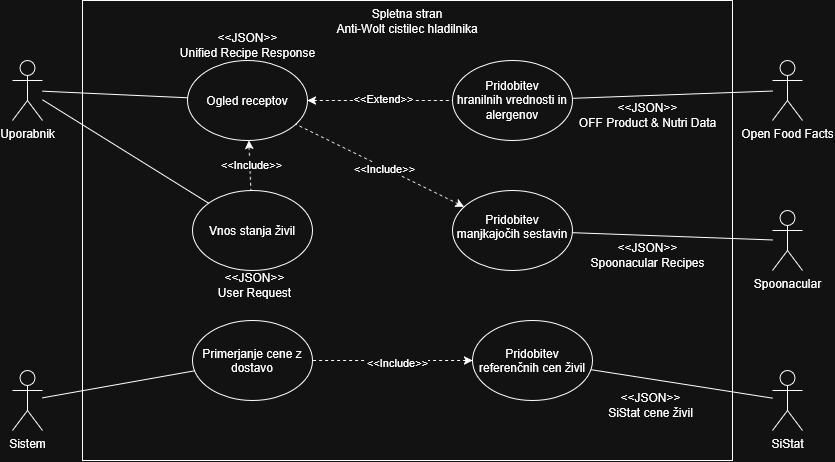

# Anti-Wolt: Čistilec Hladilnika
*Projekt pri predmetu Tehnologije Digitalizacije in Integracije Storitev (TIDS)*

**Študent:** Mihajlo Dejanović (`mihajlo.dejanovic@student.um.si`)  
**Izobraževalna institucija:** Univerza v Mariboru, Fakulteta za elektrotehniko, računalništvo in informatiko (UM FERI)  
**Asistenta za oceno:** [@alenrajsp](https://github.com/alenrajsp), [@patrikrek](https://github.com/patrikrek)  
**GitHub repozitorij:** [https://github.com/McTehno/Anti-Wolt-cistilec-hladilnika](https://github.com/McTehno/Anti-Wolt-cistilec-hladilnika)

---

## 1. Predstavitev ideje in domena projekta

### 1.1 Domena
Projekt sodi v panogo **informacijsko-komunikacijskih tehnologij (IKT)**, **trajnostne potrošnje hrane (Zero Waste)** ter **optimizacije osebnih financ**.

### 1.2 Povzetek rešitve
Bistvo rešitve je pametni spletni asistent, ki preprečuje zavrženje hrane ter zmanjšuje nepotrebne stroške naročanja pripravljene hrane prek dostavnih služb (kot sta Wolt in Glovo). 

Uporabnik v aplikacijo vnese razpoložljiva živila, ki jih že ima doma v hladilniku ali shrambi. Sistem ta živila analizira, poišče ustrezne kulinarične recepte za maksimalno porabo obstoječih sestavin, pridobi podrobne hranilne vrednosti in alergene ter izračuna oceno finančnega prihranka domačega kuhanja v primerjavi s povprečnim naročilom dostave pripravljene hrane.

---

## 2. Inovativnost in uporabna vrednost

Za razliko od klasičnih platform, ki ponujajo le statično brskanje po receptih ali zgolj naročanje hrane, rešitev združuje kulinarično iskanje, prehransko zavednost in finančno spodbudo:

- **Zmanjševanje odpadkov (Zero Waste):** Algoritem razvršča recepte na podlagi največjega deleža porabljenih obstoječih sestavin (`usedIngredientCount`) in minimalnega števila manjkajočih sestavin (`missedIngredientCount`).
- **Prehranska transparentnost in lokalni trg:** Z integracijo baze *Open Food Facts* uporabnik za živila takoj vidi hranilni profil (Nutri-Score, makrohranila) ter opozorila o morebitnih alergenih, s poudarkom na izdelkih, prisotnih na slovenskem trgu.
- **»Anti-Wolt« kalkulator prihranka:** Sistem ob vsakem receptu izračuna oceno prihranka v evrih glede na referenčne cene živil in povprečno ceno dostavljenega obroka, kar uporabnika finančno motivira za kuhanje doma.

---

## 3. Akterji in arhitekturni diagram

### 3.1 Akterji v sistemu
- **Uporabnik:** Vnaša razpoložljiva živila prek spletnega vmesnika, pregleduje predlagane recepte ter izbira želeni obrok.
- **Sistem (Backend / Orkestrator):** Validira uporabniški vnos, izvaja poizvedbe na zunanje API storitve, normalizira podatke, izvaja preslikavo sestavin ter izračunava metriko finančnega prihranka.
- **Spoonacular API:** Zunanja storitev za iskanje ustreznih receptov glede na vnesene sestavine in prepoznavo manjkajočih živil.
- **Open Food Facts API:** Zagotavlja podatke o hranilnih vrednostih, alergenih in ocenah Nutri-Score.
- **SiStat (SURS):** Zagotavlja uradne statistične cene osnovnih živil na slovenskem trgu za izračun stroškovne učinkovitosti.

### 3.2 Diagram primerov uporabe in toka podatkov
Spodnji diagram ponazarja vloge akterjev, primere uporabe in izmenjavo podatkovnih dokumentov:



#### Ključni primeri uporabe (Use Cases):
1. **Vnos stanja živil (`User Request`):** Uporabnik vnese seznam živil iz hladilnika.
2. **Ogled receptov (`Unified Recipe Response`):** Prikaz agregiranih podatkov z recepti, hranilnimi vrednostmi in prihrankom.
3. **Pridobitev manjkajočih sestavin (`Spoonacular Recipes`):** Klic Spoonacular API-ja glede na sestavine.
4. **Pridobitev hranilnih vrednosti in alergenov (`OFF Product & Nutri Data`):** Klic Open Food Facts baze za obogatitev sestavin s prehranskim profilom.
5. **Primerjanje cene z dostavo & Pridobitev referenčnih cen živil (`SiStat cene živil`):** Pridobitev cenovnih podatkov iz SiStat in primerjava z referenčnim stroškom dostave.

---

## 4. Zunanje spletne storitve (API)

| Storitev | Končna točka (Endpoint) | Metoda | Dokumentacija | Opis delovanja |
| :--- | :--- | :---: | :--- | :--- |
| **Spoonacular Food API** | `/recipes/findByIngredients` | `GET` | [spoonacular.com/food-api/docs](https://spoonacular.com/food-api/docs#Search-Recipes-by-Ingredients) | Iskanje receptov glede na razpoložljive sestavine, vrača število porabljenih in manjkajočih sestavin. |
| **Open Food Facts API** | `/api/v2/product/{barcode}` ali `/cgi/search.pl` | `GET` | [openfoodfacts.github.io/api-documentation](https://openfoodfacts.github.io/api-documentation/) | Pridobivanje podatkov o hranilnih vrednostih, makrohranilih, alergenih in oceni Nutri-Score. |
| **SiStat (SURS)** | `/SiStatData/api/v1/sl/Data/1507701S.px` | `GET` / `POST` | [pxweb.stat.si/SiStat](https://pxweb.stat.si/SiStat/sl) | Dostop do podatkov o povprečnih maloprodajnih cenah osnovnih živil v Sloveniji. |

---

## 5. Opis podatkov in dokumentov

### 5.1 Vhodni dokument uporabnika (`User Request`)
Dokument v formatu **JSON**, ki ga spletni vmesnik posreduje sistemu:
```json
{
  "fridge_items": [
    "jajca",
    "sir",
    "paradižnik",
    "testenine"
  ]
}
```

### 5.2 Interni preslikovalni slovar (`Translation/Mapping Document`)
Interni **JSON** šifrant za semantično preslikavo slovenskih poimenovanj živil v angleške poizvedbene termine za zunanje API-je:
```json
{
  "jajca": "eggs",
  "sir": "cheese",
  "paradižnik": "tomato",
  "testenine": "pasta"
}
```

### 5.3 Podatki zunanjih storitev
- **Spoonacular Recipes (`JSON`):** Vsebuje identifikatorje receptov (`id`), naslove (`title`), povezave do slik, sezname uporabljenih (`usedIngredients`) in manjkajočih sestavin (`missedIngredients`).
- **Open Food Facts Data (`JSON`):** Vsebuje `nutriscore_grade`, energijsko vrednost (`energy-kcal_100g`), vsebnost beljakovin, maščob in ogljikovih hidratov ter seznam alergenov (`allergens_tags`).
- **SiStat cene živil (`JSON` / `CSV`):** Vsebuje časovno serijo in zadnje veljavne povprečne cene na enoto mere (npr. EUR / kg ali EUR / kos).

### 5.4 Agregirani izhodni dokument (`Unified Recipe Response`)
Enoten **JSON** dokument, ki ga vrne backend in združuje vse obdelane podatke:
```json
{
  "recipe": {
    "id": 642582,
    "title": "Hitra paradižnikova omaka s testeninami in sirom",
    "preparation_time_min": 20,
    "used_ingredient_count": 3,
    "missed_ingredient_count": 2,
    "used_ingredients": ["sir", "paradižnik", "testenine"],
    "missed_ingredients": ["česen", "oljčno olje"]
  },
  "nutrition_and_allergens": {
    "nutriscore_grade": "b",
    "calories_kcal": 485,
    "allergens": [
      "mleko",
      "gluten"
    ]
  },
  "financial_metric": {
    "estimated_home_cost_eur": 2.20,
    "avg_delivery_cost_eur": 11.50,
    "savings_eur": 9.30
  }
}
```

---

## 6. Načrt integracije in potek izvedbe

1. **Priprava podatkovnega sloja:** Priprava internega preslikovalnika živil ter konfiguracija API odjemalcev za Spoonacular, Open Food Facts in SiStat.
2. **Implementacija backend orkestratorja:**
   - Validacija seznama razpoložljivih živil.
   - Poizvedba po receptih prek storitve Spoonacular.
   - Obogatitev sestavin s prehranskim profilom prek Open Food Facts.
   - Izračun ocene stroška sestavin s podatki SiStat ter izračun prihranka napram povprečni dostavi.
3. **Uporabniški vmesnik:** Intuitiven vmesnik za hiter vnos živil, prikaz zadetkov z jasnimi oznakami prihranka in hranilnih vrednosti.
4. **Oddaja in verzioniranje:** Sprotno beleženje napredka z uveljavljanjem sprememb prek sistema Git v repozitoriju.

---

## 7. Praktična naloga: Priprava XML podatkov in aplikacija za obdelavo

V sklopu naloge za obdelavo podatkovnih formatov XML in JSON je implementiran modul za upravljanje z zalogo hladilnika in shrambe.

### 7.1 Struktura pripravljenih XML dokumentov

V mapi `podatki/` se nahajata dve povezani XML datoteki:

1. **`podatki/kategorije.xml`**
   - Vsebuje 10 kategorij živil (npr. Mlečni izdelki, Sveža zelenjava, Meso in perutnina, Žita in testenine ...).
   - Vsaka kategorija ima unikaten ID atribut (`kat-01`, `kat-02` ...), priporočeno temperaturo shranjevanja, datum zadnje posodobitve ter morebitno opombo (kjer je pri nekaterih polje prazno).
2. **`podatki/zivila.xml`**
   - Vsebuje 15 živil z unikatnimi ID atributi (`ziv-01` do `ziv-15`).
   - Povezuje se z dokumentom kategorij prek elementa `<kategorijaId>`.
   - Vključuje količino, enoto mere, ocenjeno ceno v EUR, datum vnosa, rok uporabe (YYYY-MM-DD) ter opombo (z vključenimi praznimi vrednostmi).

### 7.2 Delovanje aplikacije (`main.py`)

Aplikacija je napisana v jeziku Python in omogoča:
- **Nalaganje in deserializacijo:** Prebere obe XML datoteki ter njuno vsebino pretvori v Python objekte (`Kategorija`, `Zivilo`).
- **Povezovanje podatkov (relacije):** Živilom na podlagi `kategorijaId` pripne pripadajoči naziv kategorije.
- **Interaktivno filtriranje:** Uporabnik lahko v konzoli izbere način filtriranja:
  1. Živila, ki jim kmalu poteče rok uporabe (rok uporabe $\le$ izbrani datum).
  2. Živila z nizko zalogo (količina pod določeno mejo).
  3. Živila določene kategorije.
  4. Prikaz vseh živil.
- **Pregleden izpis:** Rezultati se izpišejo v konzoli v obliki pregledne tabele.
- **Izvoz v JSON (`filtrirano.json`):** Filtrirani zapisi se izvozijo v strukturiran JSON format.
- **Izvoz v XML (`filtrirano.xml`):** Filtrirani zapisi se izvozijo v nov, veljaven XML dokument z obogatenimi podatki.

### 7.3 Navodila za zagon

Za zagon potrebujete le nameščen Python (različica 3.9 ali novejša). Aplikacija uporablja izključno standardne knjižnice (`xml.etree.ElementTree`, `json`, `os`, `sys`, `datetime`), zato dodatna namestitev knjižnic (`pip install`) ni potrebna.

1. Odprite terminal v korenski mapi projekta.
2. Zaženite program:
   ```bash
   python main.py
   ```
3. Sledite navodilom na zaslonu:
   - Izberite številko želenega filtra (1-4) in po potrebi vnesite parameter ali pritisnite `Enter` za privzeto vrednost.
4. Program bo izpisal tabelo v konzolo ter ustvaril datoteki `filtrirano.json` in `filtrirano.xml`.

---

## 8. Praktična naloga: Spletni razčlenjevalnik (Web Scraper & Parser)

V mapi [`recipe_scraper/`](recipe_scraper/) je implementiran namenski spletni razčlenjevalnik za avtomatski zajem slovenskih kulinaričnih receptov iz portala [Kulinarika.net](https://www.kulinarika.net/).

### 8.1 Pomen za projekt Anti-Wolt
Namesto zanašanja na tuje API storitve (kot je Spoonacular z dnevnimi omejitvami in angleškimi poimenovanji), razčlenjevalnik ustvari lokalno podatkovno bazo pristnih domačih receptov. Ti vsebujejo strukturiran seznam sestavin (količina, enota, živilo), postopek priprave, čas kuhanja in slike, kar omogoča neposredno primerjavo z živili v uporabnikovem hladilniku.

### 8.2 Tehnološki sklad in utemeljitev (BeautifulSoup vs. Puppeteer)
- **Python + BeautifulSoup4 + Requests:** Celoten projekt je zasnovan v jeziku Python. Ker Kulinarika.net streže vsebino prek SSR (Server-Side Rendering) z bogatimi Schema.org semantičnimi oznakami (`recipeIngredient`, `recipeInstructions`), zagon težkega brskalnika prek Puppeteerja ni potreben. Rešitev z BeautifulSoupom je več desetkrat hitrejša, porabi minimalno sistemskih virov ter omogoča natančno časovno zamikanje med zahtevki.

### 8.3 Struktura modula `recipe_scraper/`
- [`models.py`](recipe_scraper/models.py): Podatkovna modela `Recipe` in `Ingredient` s podporo za pretvorbo v slovar in JSON.
- [`parser.py`](recipe_scraper/parser.py): Ekstrakcija podatkov z BeautifulSoupom, normalizacija ulomkov in kulinaričnih merskimi enot (`g`, `dag`, `kg`, `dl`, `žlica` ...).
- [`scraper.py`](recipe_scraper/scraper.py): Krmilnik s podporo za paginacijo, izbiro kategorij, spoštljivo zakasnitev ter hkraten izvoz v JSON in XML.
- [`data/recipes.json`](recipe_scraper/data/recipes.json): Zbrana baza receptov v formatu JSON.
- [`data/recipes.xml`](recipe_scraper/data/recipes.xml): Zbrana baza receptov v formatu XML.

### 8.4 Zagon razčlenjevalnika
```bash
# Namestitev odvisnosti
pip install -r recipe_scraper/requirements.txt

# Zagon strgalnika (privzeto zajame recepte in shrani v recipe_scraper/data/recipes.json)
python recipe_scraper/scraper.py --limit 50 --xml
```
